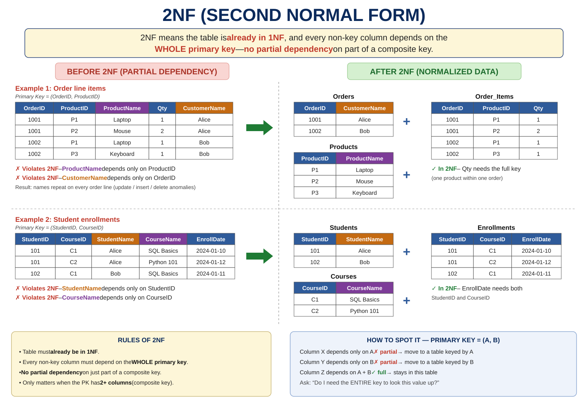

# What is 2NF?

**2NF = Second Normal Form**

The main idea is:

> **A table must first be in 1NF, and every non-key column must depend on the WHOLE primary key, not just part of it.**

In textbook / interview language you'll often hear the same rule phrased formally:

> **Every non-prime attribute must depend on the entire candidate key, not just part of it.**

- **Functional dependency `X → Y`**: if you know X, there is exactly one value of Y.
- **Candidate key**: any minimal set of columns that uniquely identifies a row. The primary key is the candidate key you picked.
- **Prime attribute**: a column that is part of some candidate key.
- **Non-prime attribute**: a column that is not part of any candidate key. This note calls these "non-key columns".

This rule only matters when a table has a **composite primary key** (a primary key made of two or more columns).

If a table has a single-column primary key, it is automatically in 2NF (assuming it's already in 1NF) — there's no "part of the key" for anything to partially depend on.

There are two things you should focus on:

1. **The table must already satisfy 1NF**
2. **No partial dependency** — no non-key column should depend on only one part of a composite key

Let's see this with examples.

---

# What is a "partial dependency"?

A partial dependency happens when a non-key column depends on **only part** of a composite primary key, instead of the full key.

Example of a composite key:

```text
PRIMARY KEY (order_id, product_id)
```

If some column only needs `order_id` to be determined, or only needs `product_id`, that's a **partial dependency** — and it violates 2NF.

---

# Example 1 — Order Items with partial dependency

Suppose we have this table:

| order_id | product_id | product_name | quantity | customer_name |
| -------- | ---------- | ------------ | -------: | -------------- |
| 1001     | P1         | Laptop       |        1 | Alice           |
| 1001     | P2         | Mouse        |        2 | Alice           |
| 1002     | P1         | Laptop       |        1 | Bob             |
| 1002     | P3         | Keyboard     |        1 | Bob             |

The primary key here is:

```text
PRIMARY KEY (order_id, product_id)
```

This is already in **1NF** — every cell has a single atomic value.

But look closely:

```text
product_name depends only on product_id
customer_name depends only on order_id
```

Neither of these needs the **full** composite key `(order_id, product_id)` to be determined.

That's a **partial dependency**, and it violates 2NF.

### Why is this a problem?

- **Data redundancy**: "Laptop" is stored again on every order line for P1, and "Alice" again on every line of order 1001.
- `product_name` for "P1" is repeated every time P1 appears in any order. If the product name changes, you must update it in multiple rows (update anomaly).
- `customer_name` for order 1001 is repeated across every product line in that order. Same problem.
- If a product has never been ordered, you can't store its name at all (insertion anomaly).
- If you delete the only order line for a product, you lose the product's name entirely (deletion anomaly).

---

## Fixing it — split by what each column actually depends on

### Orders table (depends only on order_id)

| order_id (PK) | customer_name |
| ------------- | ------------- |
| 1001     | Alice           |
| 1002     | Bob             |

### Products table (depends only on product_id)

| product_id (PK) | product_name |
| --------------- | ------------ |
| P1         | Laptop        |
| P2         | Mouse         |
| P3         | Keyboard      |

### Order_Items table (depends on the full composite key)

| order_id (PK, FK) | product_id (PK, FK) | quantity |
| ----------------- | ------------------- | -------: |
| 1001     | P1         |        1 |
| 1001     | P2         |        2 |
| 1002     | P1         |        1 |
| 1002     | P3         |        1 |

Now:

- `customer_name` lives with `order_id` alone, where it truly belongs.
- `product_name` lives with `product_id` alone, where it truly belongs.
- `quantity` genuinely needs **both** `order_id` and `product_id` — it's specific to one product within one order.

This is 2NF.

> **PK** = primary key, **FK** = foreign key. In `Order_Items`, `order_id` and `product_id` together form the primary key, and each is also a foreign key pointing back to `Orders` and `Products`.

---

# Example 2 — Student enrollments

Suppose we track which students are enrolled in which courses:

| student_id | course_id | student_name | course_name | enrollment_date |
| ---------- | --------- | ------------- | ------------ | ---------------- |
| 101        | C1        | Alice         | SQL Basics   | 2024-01-10        |
| 101        | C2        | Alice         | Python 101   | 2024-01-12        |
| 102        | C1        | Bob           | SQL Basics   | 2024-01-11        |

Primary key:

```text
PRIMARY KEY (student_id, course_id)
```

Why do we need both columns?

- One student can enroll in many courses, so `student_id` alone repeats.
- One course can have many students, so `course_id` alone repeats.
- Only the combination identifies exactly one enrollment row.

Dependencies:

```text
student_name      → depends only on student_id
course_name       → depends only on course_id
enrollment_date   → depends on BOTH student_id and course_id
```

`student_name` and `course_name` are partial dependencies. Violates 2NF.

## Fixing it

### Students

| student_id (PK) | student_name |
| --------------- | ------------ |
| 101        | Alice          |
| 102        | Bob            |

### Courses

| course_id (PK) | course_name |
| -------------- | ----------- |
| C1        | SQL Basics    |
| C2        | Python 101    |

### Enrollments

| student_id (PK, FK) | course_id (PK, FK) | enrollment_date |
| ------------------- | ------------------ | --------------- |
| 101        | C1        | 2024-01-10        |
| 101        | C2        | 2024-01-12        |
| 102        | C1        | 2024-01-11        |

`enrollment_date` stays here because it genuinely describes **this student's enrollment in this specific course** — it needs both parts of the key.

---

# A very important point — 2NF only applies to composite keys

If your table looks like this:

| employee_id | employee_name | department |
| ----------- | -------------- | ----------- |
| 1           | John           | Sales        |
| 2           | Sarah          | IT           |

Primary key is just `employee_id` — a single column.

There's no "partial" key to depend on, so this table can't violate 2NF. As long as it's in 1NF, it's automatically in 2NF too.

**2NF problems only show up when the primary key has two or more columns.**

---

# How to spot a 2NF violation — a simple test

Ask yourself, for every non-key column:

> "Do I need the **entire** primary key to look this value up, or could I find it using just **part** of the key?"

If the answer is "just part of the key," it's a partial dependency, and it belongs in its own table.

```text
PRIMARY KEY (A, B)

column X → depends only on A        ❌ partial dependency
column Y → depends only on B        ❌ partial dependency
column Z → depends on A and B       ✅ fine, stays in this table
```

---

# Why do we even care about 2NF?

Because partial dependencies cause the same kinds of anomalies 1NF was solving, just one level deeper:

- **Data redundancy** — the same product or customer name is stored again on every row it appears in, wasting space and inviting inconsistency.
- **Update anomaly** — change a product's name, and you must update it everywhere that product appears in order lines.
- **Insertion anomaly** — you can't add a new product until someone orders it, because the product only "exists" inside order rows.
- **Deletion anomaly** — delete the last order containing a product, and the product's name disappears with it.

Splitting out the partially-dependent columns into their own tables (keyed by the part of the composite key they actually depend on) removes all of these problems.

---

# 2NF in one picture

```text
                    2NF
                     │
      ┌──────────────┴───────────────┐
      │                              │
  Must be in 1NF              No partial dependency
      │                              │
      ↓                              ↓
Atomic, no repeating        Non-key column depends on
     groups                  the WHOLE composite key
      │                              │
      └──────────────┬───────────────┘
                      ↓
         Split columns that depend on
         only part of the key into
              their own tables
```

---

# 1NF vs 2NF — the key difference

| 1NF | 2NF |
| --- | --- |
| Each cell holds a single, atomic value | Must satisfy 1NF **and** remove partial dependencies |
| Focuses on the **structure of values** in cells | Focuses on **how columns depend on keys** |
| Removes multi-valued cells and repeating groups | Moves columns that depend on part of a composite key into their own table |
| A table can be in 1NF and still have partial dependencies | A table in 2NF has no partial dependency on any candidate key |
| Applies to every table | Only changes anything when a table has a composite key |

---

# One thing to remember for interviews

If an interviewer asks:

**"What is 2NF?"**

A strong answer is:

> **Second Normal Form requires a table to first be in 1NF, and additionally requires that every non-key column depend on the entire primary key — not just part of it. This rule only applies to tables with composite primary keys.**

And if they ask for an example:

> "If an Order_Items table has a composite key of `(order_id, product_id)`, but also stores `product_name` — which only depends on `product_id` — that's a partial dependency and violates 2NF. We fix it by moving `product_name` into a separate Products table keyed by `product_id`."

---

## The progression you should remember

```text
UNNORMALIZED
     ↓
    1NF
     ↓
    2NF
     ↓
    3NF
```

**1NF → Remove repeating/multi-valued data**

**2NF → Remove partial dependency** (only relevant with composite keys)

**3NF → Remove transitive dependency**

Since you're preparing for **Data Engineering interviews**, the next step is understanding **3NF**, where the focus shifts to **non-key columns depending on other non-key columns** instead of the primary key — that's a transitive dependency.
